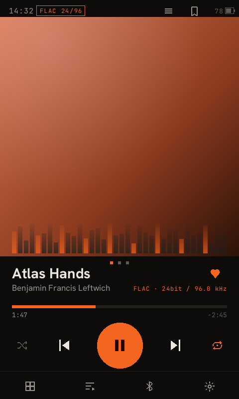
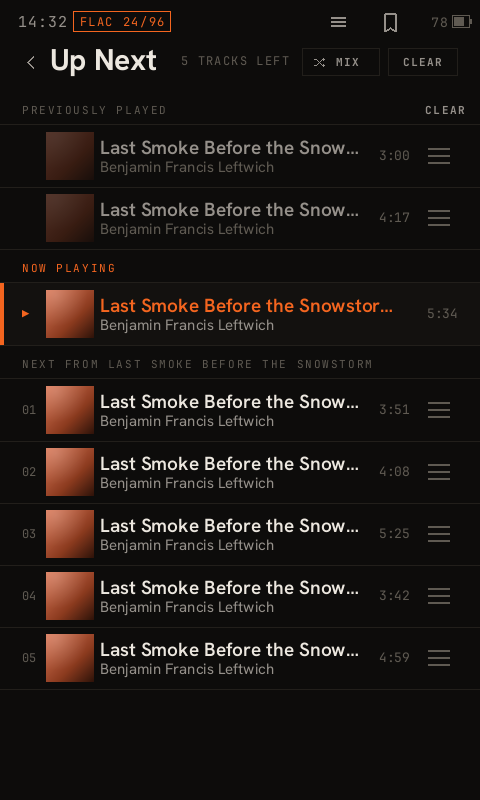
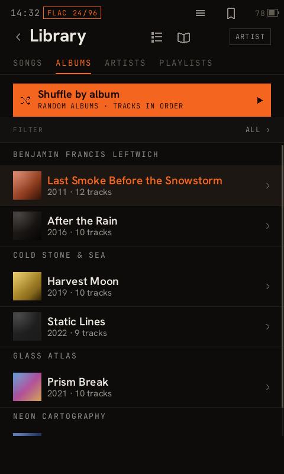

# Cinder

**A replacement music player for the Sony NW-A55 Walkman and the rest of the NW-A50 series.**
It replaces Sony's music app with a faster one and keeps Sony's audio services, effects and DAC path
underneath. Install it from a PC over USB; the same installer puts Sony's app back.

> This is a personal project that was made for myself. If people want to tweak it and adapt it to
> their own use, please do, but I can't promise features or time for it. Raise issues in the issues
> section, but I can't promise they will be patched. **Back up before you install**
> ([how](#install)), and if you have the time and skill, please contribute pull requests.
>
> I have deliberately not included any way to sponsor or pay for this project. I want it to be free,
> and I don't want the obligation for support that comes with payment; as I said, I made this for me.
>
> I am aware that using AI to create this is an unpopular decision, but I do not have the time or
> skill to make it in a "morally correct" way. Every feature that is added is based on whether I think
> it will be useful, helpful or if it is requested. This project came from me wanting something that
> didn't exist to the level I wanted it at the time.
>
> I do hope in time a community will form around this project and that people will support it and use
> it in every way that they want to. I hope Cinder does what you want it to; if not, make a request!
> The best way to support it is to test, give feedback and patch.
>
> **Cinder is still in testing and development, whatever GitHub's labels say. Updates are always
> being pushed (at the moment at least).**

  
  
  

## What you get

- **Fast.** About 5.7 MB of native code, no UI framework. Sony's app is Qt.
- **A real queue.** Up Next with play next, drag to reorder, and playlists made on the player.
- **Your library as it is.** Cinder reads Sony's database, so music, playlists and liked songs stay.
  It also plays albums kept as one file with a `.cue` sheet, lists audiobooks by series, and
  searches artists, albums and audiobooks as well as songs.
- **Short track previews.** A standalone retro page previews the current queue for 4 or 15 seconds
  per track, using existing Sony chorus markers when available ([controls and behaviour](docs/TRACK_PREVIEWS.md)).
- **USB-DAC in, LDAC out, at once.** Use the Walkman as a PC sound card and send the audio on to
  Bluetooth headphones. Sony's app blocks this; the hardware doesn't. An optional low-latency USB
  DAC (about 50 ms, headphone jack only) is there for video and games, and switches off again
  without a restart.
- **All of Sony's sound features:** DSEE HX and DSEE AI, VPT, Clear Phase, DC Phase Linearizer,
  Vinyl Processor, Clear Bass, the 10-band EQ and tone control. Cinder drives Sony's own services
  rather than reimplementing them. On top: an EQ in the DAC chip itself, named presets (one per
  album or song if you like), your own volume curve, and a signal path that says what costs battery.
- **Bluetooth codecs:** LDAC as Sony ships it, plus optional AAC and SBC XQ.
- **Better battery.** With the screen off, Cinder powers the display hardware down and lets the chip
  reach its deepest idle state. Sony's audio path is untouched.
- **Extras:** a `.scrobbler.log` scrobbler, lyrics (`.lrc` or embedded), SensMe™ channels, FM
  radio with a signal meter and recording, ATRAC files, and colour palettes you drop on the drive
  ([share and download them](https://github.com/superwilso/cinder-themes)).
- **Your layout.** Open on the Library, Now Playing, the Menu or wherever you left off. Six Now
  Playing styles: Cinder, Nocturne, Terminal, Clock, Cassette (with your own tapes) and Winamp
  (with classic `.wsz` skins). Big view for larger text and buttons, your own font, and an optional
  pull-down panel for brightness, Bluetooth, night mode and the sleep timer.
- **Your language.** English and Simplified Chinese, chosen in the installer, and a
  [guide](docs/LOCALIZATION.md) for adding another.

## Status

A daily player on the developer's own unit. Every [`CHANGELOG.md`](CHANGELOG.md) entry says whether
it has run on hardware (*device-verified*). Per-feature state: [`cinder-home/STATUS.md`](cinder-home/STATUS.md).

**Known issues**

- **v0.3.9 doesn't start after a fresh install** ([#16](../../issues/16)). Fixed in **v0.3.12**:
  install it over the top.
- **Bluetooth receiver mode (Walkman as a speaker) is experimental.** Playing from a Windows PC
  works. iPhones won't connect, and some don't list the Walkman at all.
- **Experimental options**, off by default: the low-latency USB DAC, FM recording, ATRAC playback
  and the macOS installer. Each one's state is in [`cinder-home/STATUS.md`](cinder-home/STATUS.md).
- **One test unit.** Other NW-A50-series models share its firmware but haven't been tried.

## Supported players

| Player | Already on it | Cinder | Run on the developer's A55 |
|---|---|---|---|
| NW-A55 | Sony stock 1.02 | **Supported.** The main target. | Daily, now |
| NW-A55 | Stock 1.02 + Wampy | **Supported.** Install over it; Wampy can stay ([below](#with-wampy-installed)). | Daily, July–September 2026 |
| NW-A55 | Walkman One 3.02 | **Supported.** A few sound features differ ([Walkman One](#walkman-one)). | Daily, September–October 2026 |
| NW-A55 | Walkman One 3.02 + Wampy | **Supported.** Install over it; Wampy can stay. | Late September 2026 |
| NW-A55 | Other stock or Walkman One versions | **Not tried.** | — |
| NW-A56 / A57 | Any of the above | **Should work.** Same firmware as the A55; no reports yet. | — |
| A40 / A30 series, ZX300, WM1A/Z, DMP-Z1 | Anything | **Not supported.** Use [Wampy](https://github.com/unknown321/wampy), which covers the whole MT8590 family. If you own one and can test, get in touch through GitHub. | — |

A [device report](../../issues/new/choose) for a row marked "should work" or "not tried" helps,
whether it works or not.

### With Wampy installed

You don't need to uninstall Wampy first.

- **Files:** Cinder keeps its files in its own folder and leaves Wampy's alone.
- **Wampy's screen:** it doesn't appear while Cinder runs. Wampy draws over Sony's music app, and
  Cinder takes that app's place.
- **Uninstalling Cinder** brings Sony's app back, and Wampy works over it as before.
- **Mono and soundscapes over music:** the `mono` install option loads through the same slot in
  Sony's sound service that Wampy uses, and Wampy's library still loads. On a player without Wampy,
  the `preload` option does this job.
- **Scrobbling:** Wampy's scrobbler keeps running. Cinder writes no `.scrobbler.log` of its own
  while Wampy's scrobbler is running, so no play is counted twice.

## Install

1. **Back up the player** with [wbrt](https://github.com/unknown321/wbrt) (Windows), or with
   Cinder's own `cinder-rescue dump`, which can later put back just the partitions a boot loop
   broke ([`RECOVERY.md`](RECOVERY.md) Step 3; on the [Releases](../../releases) page from v0.3.21-rc1).
   Either one saves a player that no longer starts.
2. Download the installer from [Releases](../../releases):
   - **Windows:** `cinder-installer-windows-x64.exe`. Accept the administrator prompt; the last step
     needs raw drive access.
   - **Linux:** `cinder-installer-linux-x64`, run with `sudo`.
   - **macOS** (experimental): `cinder-installer-macos`, run with `sudo`. Not yet tried on a real
     Mac with a player; Windows or Linux is the sure route.
3. Connect the Walkman in USB mass-storage mode, run the installer, choose **Install** and your
   options. The player reboots into its updater, installs, and starts Cinder. **Leave the cable in
   until it does.**

The installer also has **Update** (keeps your choices) and **Uninstall** (restores Sony's app; music
and settings are untouched). It reads the player's logs, so it reports what is really installed.
The `.exe` is unsigned; check it against `SHA256SUMS` on the release.

Every option, and the developer build: [`install.md`](install.md). Removing it: [`UNINSTALL.md`](UNINSTALL.md).

## If something goes wrong

Each way back to Sony's player depends on less than the one before:

- **Boot with the USB cable connected** → Sony's player. Needs no filesystem. (The first boot after
  an install ignores the cable once.)
- **A file named `cinderhome_off` on the drive** → Sony's player until you delete it.
  `cinderhome_clear` clears a latched failure and tries Cinder again.
- **A build that fails to start** reverts to Sony's player by itself after four boots.
- **A player that doesn't start at all** still has MediaTek's download mode, before any of its
  software: restore your backup with `cinder-rescue restore` or wbrt.

Read [`RECOVERY.md`](RECOVERY.md) **before** you need it. Attach `cinderhome.log` (root of the
drive) to any issue.

## Walkman One

Cinder runs on Walkman One 3.02 as well as on Sony's stock 1.02, and installs the same way: Walkman
One changes the key Sony's updater accepts, and the installer asks the player for its key and
writes the package that key opens. Everything in Cinder works there except:

- **VPT Surround, Clear Phase and DSEE AI** aren't in Walkman One's sound library. Cinder shows
  them as unavailable rather than letting a tap do nothing.
- **Clear Bass** isn't in Walkman One's sound effects either. The install option *Clear Bass
  (Walkman One 3.02 only)* puts it back, in place of the DC Phase Linearizer.
- **Noise cancelling** (Sony's NC earphones): Walkman One never starts Sony's noise-cancelling
  engine, so Cinder starts it when you switch NC on. Ambient sound isn't available: Walkman One
  removed its filter.
- **Other versions** of Walkman One haven't been tried.

Coming from Walkman One:

- **Sound:** Walkman One's plus modes are a 3-byte change to Sony's audio library. Cinder's
  *Sound signature* install option makes the same change to your own stock files, no flashing. Its
  external tunings are other models' firmware and can't be reproduced. Measured at the jack, neither
  changes the signal ([unknown321's measurements](https://github.com/unknown321/wampy/blob/master/MAKING_OF_VOLUME_TABLES.md#there-is-more)).
- **Volume curve:** Cinder removes Sony's regional volume limit by default; the *Headphone volume
  curve* option **Sony, with region limit** keeps it. **Smooth (NW-WM1A)** is a choice there too, if
  you supply Sony's table file ([how](install.md#the-volume-curve-tables)).
- **Reverting to stock first** works; Cinder installs on stock 1.02. If it then doesn't start,
  you're on v0.3.9 ([#16](../../issues/16)): use a newer release.

Teardown of Walkman One: [`analysis/RE_walkmanone_extract.md`](analysis/RE_walkmanone_extract.md).

## Contributing and building

Issues and pull requests are welcome. **The most useful contribution is a device report:** run one
item from [`docs/DEVICE_CHECKLIST.md`](docs/DEVICE_CHECKLIST.md) and post the result, pass or fail.
Designing a palette, a screen or a whole style? Start with
[`docs/DESIGN_GUIDE.md`](docs/DESIGN_GUIDE.md).
[`CONTRIBUTING.md`](CONTRIBUTING.md) covers the local checks, the rules for boot-path code, and
releases. Docs index: [`docs/README.md`](docs/README.md).

| Path | Contents |
|---|---|
| `cinder-home/` | The C++ Home app: lifecycle, watchdogs, glue to Sony's services, the LDAC bridge, the installer payload |
| `player/` | The Rust UI (`cinder-ui`), its C boundary (`cinder-ffi`), the library reader, and host tools that render every screen to PNG |
| `installer/` | The end-user installer (Windows GUI and text UI), dependency-free Rust |
| `rescue/` | `cinder-rescue`: back up, verify and restore the eMMC over MediaTek's download mode |
| `cinder-aac/` | The Bluetooth AAC encoder option |
| `analysis/`, `docs/` | Reverse-engineering notes, audits and plans |

UI work needs no device: `cd player && cargo run --release -p cinder-host` renders every screen to
`player/out/`. The device build needs a matched cross toolchain; see [`install.md`](install.md) and
[`CLAUDE.md`](CLAUDE.md) Parts A–D.

## Related projects

| | |
|---|---|
| [Wampy](https://github.com/unknown321/wampy) | Skinnable replacement UI for the whole MT8590 Walkman family. Its `MAKING_OF` write-ups mapped this platform first. |
| [wbrt](https://github.com/unknown321/wbrt) | Full eMMC backup and restore. Brick insurance for everything here. |
| [Walkman One](https://www.mrwalkman.com/) | Sony's player with region and feature locks removed. |
| [Rockbox `nwztools`](https://github.com/Rockbox/rockbox/tree/master/utils/nwztools) | `.UPG` packing, per-model keys and the NVP map. |
| [scrobbler](https://github.com/unknown321/scrobbler) | On-device Last.fm scrobbling. If installed, Cinder's scrobbler steps aside. |
| [Flint](https://github.com/superwilso/flint) / [Sony-sync](https://github.com/superwilso/Sony-sync) | The developer's PC sync tools. Flint writes SensMe data and syncs likes and scrobbles. |

## Screenshots

All 40 screens, from Now Playing to the Windows installer: [`docs/SCREENSHOTS.md`](docs/SCREENSHOTS.md).

## License

Cinder is free to use, change and share for any non-commercial purpose: your own player, study,
hobby projects, clubs and charities. Selling it, or building it into something you sell, is not
allowed. The terms are the [PolyForm Noncommercial License 1.0.0](LICENSE). Releases up to v0.3.18
were MIT, and those copies stay MIT; contributions made before the change keep their MIT notice.

Bundled fonts are SIL OFL 1.1 (`*-OFL.txt` beside each). The fdk-aac encoder that the `bt-aac`
option installs has its own licence ([`cinder-aac/NOTICE.fdk-aac`](cinder-aac/NOTICE.fdk-aac)). The repository
contains no Sony code or artwork; the reverse-engineering notes describe interfaces only. Rockbox's `nwztools` (GPL) is used as an external tool, not vendored.

Not affiliated with or endorsed by Sony. "Walkman" and "SensMe" are Sony's marks.

As a disclaimer, a large amount of the reverse engineering work, documentation, and Rust and C++
code was written by Claude. All work was supervised and checked by a human.
