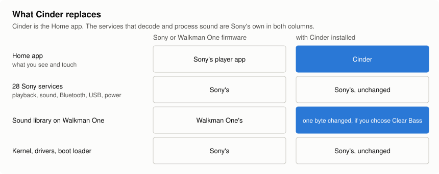
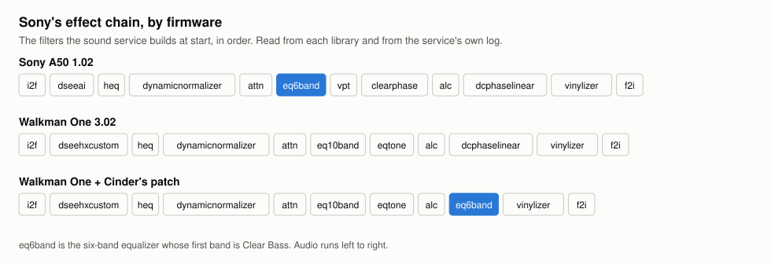
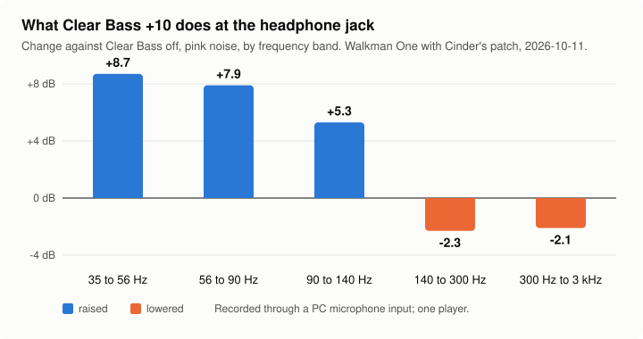
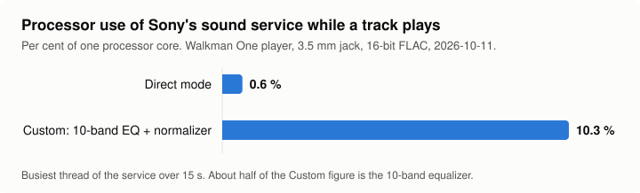
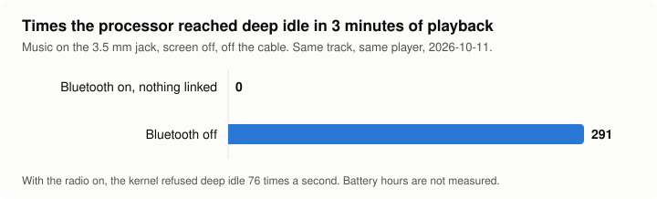

# Cinder and Sony's firmware, compared

What Cinder changes on an NW-A50 series player, what it leaves to Sony, and what was measured.
Every number on this page was taken on one Walkman One 3.02 player on 2026-10-11. Nothing here
is a battery-life figure: hours of playback have not been measured either way.

The pictures are drawn by `tools/make_compare_charts.py` from the numbers in the tables.

## What Cinder replaces

Cinder is the Home app. Decoding, effects, Bluetooth, USB and power are Sony's services under
both apps, so a difference in sound or battery comes from what is switched on, not from a
different audio engine. Sony's player app is not running while Cinder is.

## Sony's effect chain, by firmware

Walkman One ships Sony's Clear Bass code but leaves its filter (`eq6band`) out of the chain, so
Clear Bass does nothing there. Cinder's optional patch points one chain entry at it, in place
of the DC Phase Linearizer. Details: [`../analysis/RE_clear_bass.md`](../analysis/RE_clear_bass.md).

## What Clear Bass does once it is back

| Band | Clear Bass +10 against off |
|---|---|
| 35 to 56 Hz | +8.7 dB |
| 56 to 90 Hz | +7.9 dB |
| 90 to 140 Hz | +5.3 dB |
| 140 to 300 Hz | -2.3 dB |
| 300 Hz to 3 kHz | -2.1 dB |

Pink noise, headphone jack into a PC microphone input. While Clear Bass is on, the 10-band
equalizer and Tone Control are off: Sony's firmware runs one of the three at a time. Whether the
2 dB drop above 140 Hz is Sony's headroom or the equalizer's own curve leaving the path is not
separated yet.

## What the effects cost the processor

| Sound page mode | Sony's sound service, busiest thread |
|---|---|
| Direct | 0.6 % of one core |
| Custom, 10-band equalizer and Dynamic Normalizer on | 10.3 % of one core |

About half of the Custom figure is the 10-band equalizer and its limiter. The DAC EQ (Sound,
Advanced) does five bands inside the DAC chip for no processor time, on the jack only. Direct
mode holds the DAC EQ flat. In Custom with every software effect off, Sony's service skips its
chain as it does in Direct (read from its code, not measured), and the DAC EQ still applies.

## What Bluetooth costs while you listen on the jack

| Bluetooth | Deep idle entries in 3 minutes | Interrupts a second |
|---|---|---|
| On, nothing linked | 0 | 84 |
| Off | 291 | 17 |

While the jack output is open, the kernel checks whether the Bluetooth chip is powered before it
allows deep idle, and refuses if it is. This is Sony's kernel, so it applies under Sony's app
too. Cinder's "Bluetooth auto off" switches the radio off after ten minutes of this.
